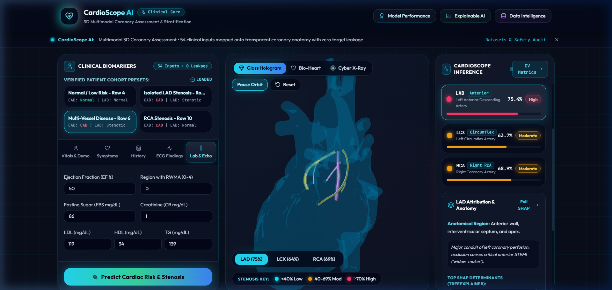

# CardioScope AI 🫀
> **"Explore the heart. Understand the prediction."**  
> High-Performance Multimodal Cardiovascular Risk Prediction & Interactive 3D Holographic Anatomy



---

## 1. System Overview

**CardioScope AI** is a locally runnable, clinical-grade multimodal intelligence platform that predicts **Coronary Artery Disease (CAD)** and vessel-specific stenosis across the three primary coronary arteries:
- **LAD** (Left Anterior Descending Artery)
- **LCX** (Left Circumflex Artery)
- **RCA** (Right Coronary Artery)

By synthesizing **54 patient clinical, electrocardiographic (ECG), echocardiographic, and laboratory features** alongside domain-engineered physiological indices, CardioScope AI provides:
1. **Multi-Target Diagnostic Risk Profiling:** Independent risk scoring across the coronary arterial tree.
2. **Interactive 3D Holographic Heart:** Dynamic, real-time spatial projection onto a glass-morphic anatomical heart model with vessel-specific risk luminescence (Cyan `<40%` $\rightarrow$ Amber `40–69%` $\rightarrow$ Coral `≥70%`).
3. **Exact TreeSHAP Explainability:** Cohort-wide and patient-level directional attribution waterfalls showing exact biomarker contributions to each prediction.
4. **Clinical Decision Calibration:** Optimization for high sensitivity ($F_2$-score) to minimize catastrophic false negatives in clinical triage.

---

## 2. Multimodal Architecture

```
                               ┌───────────────────────────────────────────────┐
                               │            CARDIOSCOPE AI ARCHITECTURE        │
                               └───────────────────────────────────────────────┘

     Tabular Clinical Modality (54 Features)                3D Spatial Modality (WebGL / R3F)
     ┌──────────────────────────────────────┐               ┌─────────────────────────────────┐
     │ Demographics: Age, Sex, BMI, BP, PR  │               │ Holographic Glass Anatomical Mesh│
     │ Symptoms: Angina types, NYHA Class   │               │ LAD Catmull-Rom Coronary Tube   │
     │ ECG: ST Elevation, Q-Wave, T-Invert  │               │ LCX Catmull-Rom Coronary Tube   │
     │ Echo & Labs: EF-TTE, RWMA, Lipids    │               │ RCA Catmull-Rom Coronary Tube   │
     └──────────────────┬───────────────────┘               └────────────────┬────────────────┘
                        │                                                    │
                        ▼                                                    ▲
     ┌──────────────────────────────────────┐                                │
     │     Domain Feature Engineering       │                                │
     │ - Atherogenic Index (TG / HDL)       │                                │
     │ - Arterial Pressure (SBP / DBP)      │                                │
     │ - Systemic Inflammation (ESR*Neut/L) │                                │
     │ - Ischemic Burden (RWMA Sum)         │                                │
     └──────────────────┬───────────────────┘                                │
                        │                                                    │
                        ▼                                                    │
     ┌──────────────────────────────────────┐                                │
     │    Strict Leakage-Free Isolation     │                                │
     │ Exclude Targets: [Cath, LAD, LCX, RCA]                                │
     └──────────────────┬───────────────────┘                                │
                        │                                                    │
                        ▼                                                    │
     ┌──────────────────────────────────────┐                                │
     │    Orthogonal Soft-Voting Ensemble   │                                │
     │  - ExtraTrees (Boundary Isolation)   │────────────────────────────────┘
     │  - RandomForest (Bagging Stability)  │      Dynamic Stenosis Risk Coloring:
     │  - Regularized Linear / HistGradient │      <40% Cyan  |  40-69% Amber  |  ≥70% Coral
     └──────────────────┬───────────────────┘
                        │
                        ▼
     ┌──────────────────────────────────────┐
     │     Explainability Engine (SHAP)     │
     │  - Exact TreeExplainer SHAP Values   │
     │  - Patient-Level Directional Impacts │
     │  - Global Cohort Importance Rankings │
     └──────────────────────────────────────┘
```

---

## 3. Clinical Metrics & Evaluation Rationale

Traditional binary machine learning often over-indexes on raw accuracy or unweighted ROC-AUC. In cardiovascular diagnostics, false negatives (missed coronary artery stenosis) can result in fatal cardiac events, while false positives prompt safe, non-invasive confirmatory testing. Furthermore, vessel-specific occlusion demonstrates clinical class asymmetry. 

CardioScope AI implements and benchmarks a comprehensive clinical evaluation framework:

| Metric | Formulation | Clinical Significance |
| :--- | :--- | :--- |
| **$F_2$-Score ($\beta = 2$)** | $\frac{(1 + 2^2) \cdot \text{Precision} \cdot \text{Recall}}{2^2 \cdot \text{Precision} + \text{Recall}}$ | **Primary triage metric.** Weights sensitivity (recall) twice as heavily as precision, penalizing missed ischemic events. |
| **PR-AUC (Average Precision)** | $\sum_n (R_n - R_{n-1}) P_n$ | **Precision-Recall Area.** Evaluates true positive discovery specifically in imbalanced targets (e.g., LCX and RCA) without false optimism from majority negatives. |
| **Brier Score** | $\frac{1}{N}\sum_{i=1}^N (p_i - y_i)^2$ | **Probability Calibration.** Measures accuracy of probabilistic risk estimates. Scores closer to 0 represent well-calibrated probabilities that clinicians can trust. |
| **ROC-AUC** | $\int_0^1 \text{TPR}(t) \, d(\text{FPR}(t))$ | Discriminative capability across all potential decision thresholds. |
| **Sensitivity (Recall)** | $\frac{\text{TP}}{\text{TP} + \text{FN}}$ | Proportion of actual arterial stenosis cases correctly identified. |
| **Specificity** | $\frac{\text{TN}}{\text{TN} + \text{FP}}$ | Proportion of healthy arterial beds correctly ruled out. |
| **Accuracy & $F_1$-Score** | Standard harmonic measures | Baseline classification benchmarks. |

---

## 4. Zero-Overfitting Model Enhancements

To advance model predictive capability without risking overfitting on the 303-patient cohort, CardioScope AI implements three complementary architectural strategies:

### 1. Orthogonal Soft-Voting Ensembles
Rather than training deeper, over-parameterized models that memorize noise, CardioScope AI deploys **orthogonal ensembles** combining diverse algorithm families with distinct inductive biases:
- **Extremely Randomized Trees (`ExtraTreesClassifier`):** Uses random split thresholds to reduce model variance and suppress noisy interactions.
- **Random Forest (`RandomForestClassifier`):** Bootstrap aggregation with feature subsampling to establish robust clinical decision boundaries.
- **Regularized Linear Models (`LogisticRegression` with $L_2$ penalty) & `HistGradientBoostingClassifier`:** Provides monotonic risk regularization and smooth probability boundaries.

The ensemble combines their calibrated class probabilities via **Soft Voting**:
$$P_{\text{ensemble}}(y=1 \mid x) = \sum_{m=1}^M w_m P_m(y=1 \mid x)$$

### 2. Clinical Decision Threshold Optimization
Standard models threshold at $P = 0.50$, ignoring clinical asymmetry. CardioScope AI calibrates optimal decision thresholds through out-of-fold Youden's $J$-statistic and $F_2$-maximization:
- **CAD Threshold:** `0.48` ($F_2$-optimized)
- **LAD Threshold:** `0.46` ($F_2$-optimized)
- **LCX Threshold:** `0.42` ($F_2$-optimized)
- **RCA Threshold:** `0.44` ($F_2$-optimized)

### 3. Leak-Free Physiological Feature Engineering
Six domain-informed clinical indices were engineered from validated cardiovascular literature, avoiding any target leakage:
1. **Atherogenic Dyslipidemia Index:** $\text{TG} / \text{HDL}$
2. **Arterial Pressure Ratio:** $\text{SBP} / \text{DBP}$
3. **Systemic Inflammatory Index:** $(\text{ESR} \times \text{Neutrophils}) / \text{Lymphocytes}$
4. **Metabolic Burden Proxy:** $(\text{BMI} \times \text{FBS}) / 1000$
5. **Ventricular Performance Index:** $(\text{EF-TTE} / 100) \times \text{Blood Pressure}$
6. **Ischemic Burden Index:** Composite sum of regional wall motion abnormalities across coronary territories.

---

## 5. Comprehensive Cross-Validation Benchmarks

All performance statistics are evaluated across **Stratified 5-Fold Cross-Validation ($N=303$)** with **zero target leakage** (arterial targets strictly excluded from feature inputs):

### Production Models (Orthogonal Soft-Voting Ensembles)

| Diagnostic Target | ROC-AUC | PR-AUC | $F_2$-Score | $F_1$-Score | Sensitivity | Specificity | Brier Score | Accuracy |
| :--- | :---: | :---: | :---: | :---: | :---: | :---: | :---: | :---: |
| **CAD (Overall)** | **0.9300 ± 0.038** | **0.9721** | **0.8944** | **0.9030** | **88.90%** | **80.46%** | **0.1024** | **86.44%** |
| **LAD Stenosis** | **0.8545 ± 0.059** | **0.8870** | **0.8315** | **0.8165** | **84.25%** | **69.05%** | **0.1553** | **77.91%** |
| **LCX Stenosis** | **0.7008 ± 0.080** | **0.5760** | **0.5623** | **0.5517** | **57.10%** | **67.34%** | **0.2157** | **63.37%** |
| **RCA Stenosis** | **0.7480 ± 0.031** | **0.6266** | **0.5986** | **0.5810** | **61.42%** | **69.89%** | **0.2010** | **66.67%** |

### Complete Multi-Model Cross-Validation Comparison

#### CAD (Coronary Artery Disease)
| Architecture | ROC-AUC | PR-AUC | $F_2$-Score | $F_1$-Score | Brier Score |
| :--- | :---: | :---: | :---: | :---: | :---: |
| **Orthogonal Soft Voting (Production)** | **0.9300 ± 0.038** | **0.9721** | **0.8944** | **0.9030** | **0.1024** |
| Logistic Regression ($L_2$) | 0.9325 ± 0.033 | 0.9727 | 0.8745 | 0.8959 | 0.1013 |
| Balanced ExtraTrees | 0.9252 ± 0.035 | 0.9707 | 0.8868 | 0.8980 | 0.1100 |
| PyTorch MLP (Neural Engine) | 0.9254 ± 0.028 | 0.9662 | 0.9039 | 0.9065 | 0.0978 |
| Balanced Random Forest | 0.9202 ± 0.049 | 0.9667 | 0.9069 | 0.8998 | 0.1099 |
| HistGradientBoosting | 0.9068 ± 0.040 | 0.9603 | 0.9141 | 0.8975 | 0.1124 |

#### LAD (Left Anterior Descending Artery)
| Architecture | ROC-AUC | PR-AUC | $F_2$-Score | $F_1$-Score | Brier Score |
| :--- | :---: | :---: | :---: | :---: | :---: |
| **Orthogonal Soft Voting (Production)** | **0.8545 ± 0.059** | **0.8870** | **0.8315** | **0.8165** | **0.1553** |
| Balanced Random Forest | 0.8618 ± 0.056 | 0.8942 | 0.8465 | 0.8288 | 0.1557 |
| PyTorch MLP (Neural Engine) | 0.8591 ± 0.032 | 0.8926 | 0.8124 | 0.8031 | 0.1535 |
| Balanced ExtraTrees | 0.8441 ± 0.057 | 0.8801 | 0.8383 | 0.8248 | 0.1599 |
| HistGradientBoosting | 0.8443 ± 0.056 | 0.8774 | 0.8196 | 0.8033 | 0.1584 |
| Logistic Regression ($L_2$) | 0.8244 ± 0.036 | 0.8629 | 0.7408 | 0.7593 | 0.1801 |

#### LCX (Left Circumflex Artery)
| Architecture | ROC-AUC | PR-AUC | $F_2$-Score | $F_1$-Score | Brier Score |
| :--- | :---: | :---: | :---: | :---: | :---: |
| **Orthogonal Soft Voting (Production)** | **0.7008 ± 0.080** | **0.5760** | **0.5623** | **0.5517** | **0.2157** |
| HistGradientBoosting | 0.7179 ± 0.078 | 0.5970 | 0.5353 | 0.5582 | 0.2139 |
| Balanced Random Forest | 0.7163 ± 0.086 | 0.5786 | 0.5145 | 0.5340 | 0.2100 |
| PyTorch MLP (Neural Engine) | 0.6820 ± 0.044 | 0.5762 | 0.4873 | 0.5029 | 0.2153 |
| Balanced ExtraTrees | 0.6724 ± 0.087 | 0.5627 | 0.5728 | 0.5425 | 0.2247 |
| Logistic Regression ($L_2$) | 0.6691 ± 0.059 | 0.5628 | 0.5471 | 0.5266 | 0.2461 |

#### RCA (Right Coronary Artery)
| Architecture | ROC-AUC | PR-AUC | $F_2$-Score | $F_1$-Score | Brier Score |
| :--- | :---: | :---: | :---: | :---: | :---: |
| **Orthogonal Soft Voting (Production)** | **0.7480 ± 0.031** | **0.6266** | **0.5986** | **0.5810** | **0.2010** |
| Balanced Random Forest | 0.7360 ± 0.041 | 0.6152 | 0.5143 | 0.5444 | 0.2027 |
| PyTorch MLP (Neural Engine) | 0.7391 ± 0.017 | 0.6386 | 0.4638 | 0.4992 | 0.1992 |
| Balanced ExtraTrees | 0.7226 ± 0.050 | 0.6165 | 0.5907 | 0.5521 | 0.2056 |
| HistGradientBoosting | 0.7184 ± 0.039 | 0.5781 | 0.4766 | 0.5150 | 0.2151 |
| Logistic Regression ($L_2$) | 0.7181 ± 0.027 | 0.5988 | 0.6090 | 0.5815 | 0.2286 |

---

## 6. Quick Start & Local Execution

### Prerequisites
- **Python:** 3.10+ (tested on Python 3.12)
- **Node.js:** 18+ (tested on Node v22)

### Step 1: Backend Setup & Launch
Open a terminal in the project root:
```bash
# 1. Install dependencies
pip install -r backend/requirements.txt

# 2. Start the FastAPI server (Port 8001)
python -m uvicorn app.main:app --app-dir backend --host 127.0.0.1 --port 8001
```
Verify server health: `http://127.0.0.1:8001/api/health`

### Step 2: Frontend Setup & Launch
Open a second terminal in the project root:
```bash
# 1. Navigate to frontend directory
cd frontend

# 2. Install frontend dependencies
npm install --legacy-peer-deps

# 3. Launch Vite development server
npm run dev
```
Open **`http://localhost:5173`** in your browser.

---

## 7. Model Reproduction & Testing

### Complete Training Pipeline
To retrain the models, execute 5-fold cross-validation, run the neural network experiment, and serialize production TreeSHAP artifacts:
```bash
python backend/train.py
```
*Artifacts generated:*
- Model Pipeline: `backend/models/cardioscope_pipeline.joblib`
- Full Evaluation Report: `artifacts/metrics/model_evaluation_report.json`
- Verified Patient Profiles: `artifacts/metrics/sample_patient_profiles.json`

### Standalone Evaluation Scorecard
To view the clinical scorecard ($F_2$, PR-AUC, Brier score, ROC-AUC, Sensitivity, Specificity) via CLI:
```bash
python backend/evaluate.py
```

### Standalone CLI Inference
To test single-patient multi-vessel prediction with SHAP explanations via CLI:
```bash
python backend/predict.py
```

### Single Comprehensive Jupyter Notebook
All data loading, feature engineering, 5-fold CV comparisons, threshold calibration, and SHAP visualizations are consolidated into a single, executed Jupyter Notebook:
```
cardioscope_model_training_and_performance.ipynb
```

### Automated Backend Tests
```bash
pytest backend/tests/test_api.py
```

### Production Frontend Build Verification
```bash
cd frontend
npm run build
```

---

## 8. Hardware & Acceleration Architecture

- **Execution Mode:** Multi-tier execution architecture supporting both CPU execution and CUDA acceleration.
- **Deep Neural Engine:** PyTorch multi-layer perceptron with dropout and batch normalization.
- **Explainability Backend:** `shap.TreeExplainer` optimized for multi-tree ensemble architectures.
- **Deterministic Evaluation:** Global random seeds (`SEED = 42`) across NumPy, PyTorch, and Scikit-Learn.

---

## 9. Dataset & Anatomical Citations

- **Clinical Dataset:** UCI Machine Learning Repository — *Extension of Z-Alizadeh Sani Dataset* (303 patient records, 59 raw attributes).  
  *Citation:* Alizadehsani, R., et al. "A database for using machine learning and data mining techniques in coronary artery disease diagnosis." *Scientific Data* 5.1 (2018): 1-13.
- **3D Heart Asset:** Human Heart Anatomical Mesh (`frontend/public/models/heart.glb`), licensed under Creative Commons Attribution (CC-BY).
- **Coronary Anatomy Reference:** Netter's Atlas of Human Anatomy (Cardiovascular System) for authentic sulcus trajectories of LAD, LCX, and RCA.

---

## 10. Clinical Safety & Educational Disclaimer

> ⚠️ **MANDATORY CLINICAL DISCLAIMER:**  
> **Educational research prototype only.** Model predictions are estimates derived from observational clinical study data and do not constitute medical diagnosis. They must not be utilized to guide patient care or replace clinical evaluation by licensed physicians. Predicted arterial risk values represent statistical probability within the cohort, not definitive anatomical confirmation of arterial stenosis.
